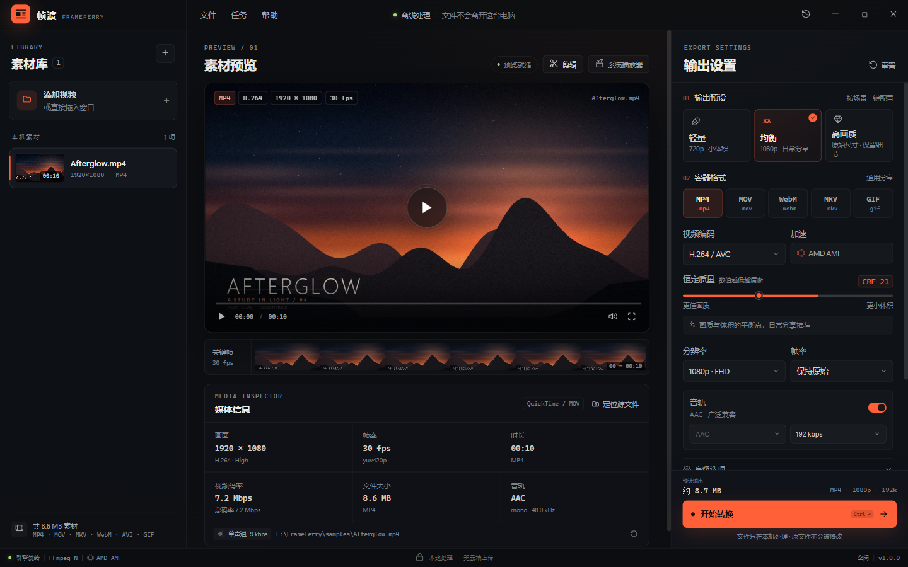
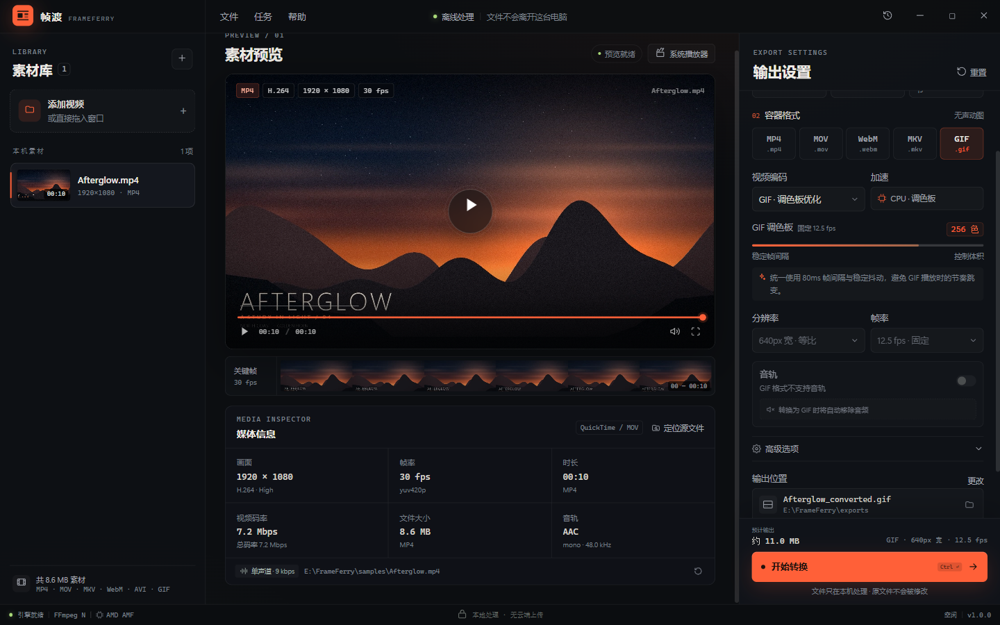
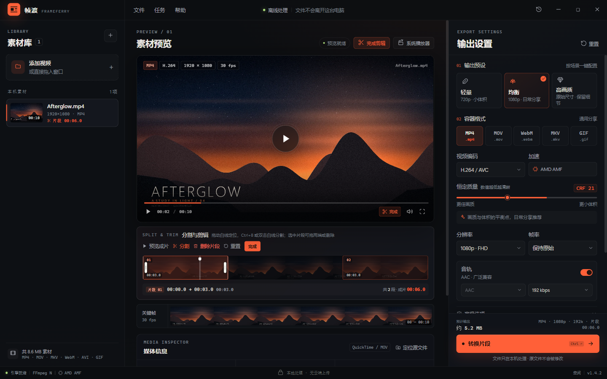
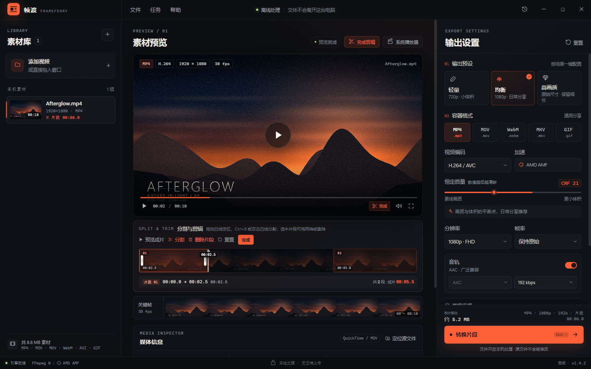
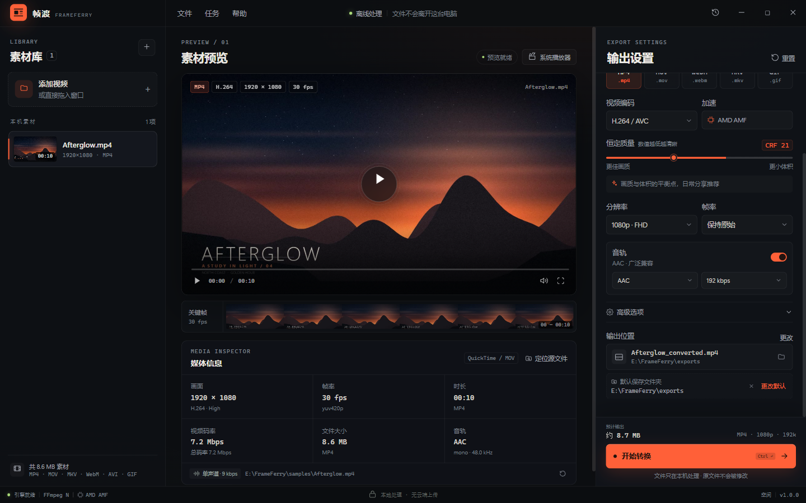
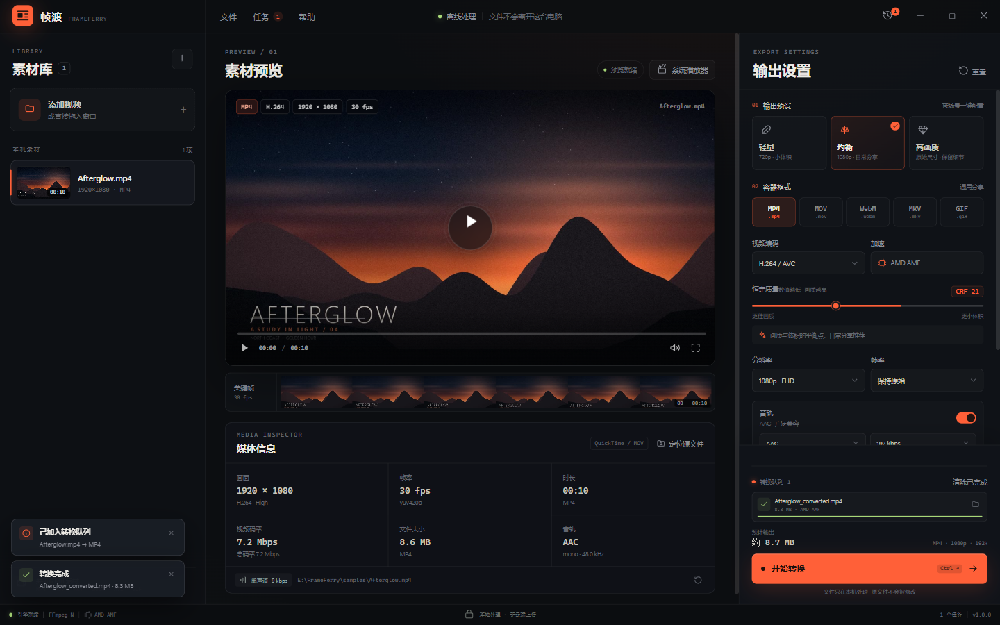

# 帧渡 FrameFerry

> 把视频安全地摆渡到另一种格式。没有上传，没有账号，也没有等待。

帧渡是一个**本地优先的 Windows 桌面视频格式转换器**。它把 FFmpeg 的能力藏进一个安静的桌面工作台：拖入素材，看到画面与媒体信息，截出需要的片段，选一个预设，转换在当前窗口完成。所有文件都留在这台电脑上。



## 立即体验

当前机器上的便携版已经放在：

```text
E:\FrameFerry\FrameFerry.exe
```

也可以双击 `E:\FrameFerry\帧渡 FrameFerry.lnk` 或 `启动帧渡.cmd`。首次打开建议把 `E:\FrameFerry\samples\Afterglow.mp4` 拖进窗口，然后点击右下角「开始转换」。

> 这是未签名的本地预览版。Windows SmartScreen 若拦截，请选择「更多信息 → 仍要运行」。应用不需要管理员权限，也不会联网。

## 需求对照

| 题目要求 | 实现 |
| --- | --- |
| 加载视频信息 | `ffprobe` 读取容器、编码、分辨率、帧率、码率、音轨、字幕数量；三种信息展示层级 |
| 获取缩略图并显示 | 海报帧 + 6 帧关键帧胶片条；按文件 mtime + 大小做哈希缓存 |
| 使用 ffmpeg 命令行转换 | Node `child_process.spawn` 直接调用 `ffmpeg.exe`，不接入任何 FFmpeg API/SDK；`-progress pipe:1` 实时解析进度 |
| 自己做一些优化 | 硬件编码探测与自动回退、串行任务队列、互不覆盖的输出命名、编码器/容器联动、体积预估、帧服务 Range 预览、首帧快启 |
| 生成会话总结 MD | [`会话总结.md`](会话总结.md)：开发过程、决策、反馈、取舍与测试记录 |
| 提交 GitHub | 本地 Git 仓库已就绪；按当前要求**先不推送**，待确认后上传 |
| 界面与「客户端」有关联 | 无边框桌面窗口、窗口控制、菜单栏、系统文件对话框、拖放、快捷键、底部任务 Dock；没有网页导航或落地页 |
| 设计目标是给人用 | 提供示例素材、完成态/失败态、取消、打开输出位置、转换记录、键盘操作，并完成端到端转换验证 |

## 界面

三栏桌面布局，而不是把网页表单塞进窗口：

- **素材库**：真实缩略图、时长与分辨率；单击切换，悬停移除；窗口任意位置拖入视频。
- **工作台**：画面预览、自定义播放控制、关键帧胶片条、媒体检查器。
- **分割与剪辑**：预览右上角或播放控制条右侧的剪刀「剪辑」按钮打开时间轴；白色竖线就是分割位置，拖动白线定位后按 `Ctrl+B`、双击白线或点「分割」，视频会被拆成多个片段，切点会留下白色分割线。选中片段后，两端出现参考剪映的白色圆角手柄，拖动即可再次裁剪，拖动时显示长度气泡；也可直接删除片段。转换按钮变为「转换片段」，FFmpeg 只导出保留的片段并按顺序拼接。
- **输出设置**：场景预设、容器/编码器联动、恒定质量、分辨率与帧率、音轨、高级选项。
- **默认保存文件夹**：设置一次，后续新素材自动使用该目录；可随时更改或恢复「跟随源文件」。选择会写入本机 `settings.json`，重启后仍然有效。
- **动作 Dock**：预计体积、主操作「开始转换」、当前/最近任务和进度常驻在视线内。
- **桌面细节**：`Ctrl+O` 添加、`Ctrl+Enter` 转换、空格播放/暂停、`Esc` 关闭浮层；系统保存对话框；输出文件在资源管理器中定位。
- **可读性**：中文控件字号 11–13px，辅助信息不低于 10px；深色界面的次要文字提高亮度，优先保证「看得清」而不是一味塞信息。
- **GIF 稳定输出**：固定 12.5fps / 80ms 帧间隔（避免 15fps 被拆成 70/60ms 的节奏跳变），256 色全局调色板 + 稳定抖动。











## 关键实现

### 1. 预览与元数据

`electron/probe.mjs` 使用 `ffprobe -print_format json` 读取媒体信息，并用两次 FFmpeg 调用生成：

- 18% 时间点的 1280px 海报帧；
- 覆盖全片的 6 帧联系表（contact sheet）。

缩略图按 `文件路径 + 大小 + mtime` 的哈希缓存到 Electron `userData/thumb-cache`。同一个素材再次打开时不再重复抽帧。

应用内播放不是把本地路径直接交给 `<video>`。主进程注册了私有协议 `frameflow://media`，实现了 **HTTP Range** 读取，所以大视频可以拖动进度条，而不必先完整加载。`nodeIntegration` 关闭、`contextIsolation` 开启、CSP 限制脚本与媒体源，文件扩展名白名单在协议层再次校验。

### 2. 分割与剪辑

每个素材维护一组按时间排序的片段：初始为一条完整片段。时间轴上的白色竖线是播放头，同时也是分割位置：可以拖动白线，或点击时间轴定位，再按 `Ctrl+B`、双击白线或点「分割」。切点会留下一条白色分割线，相邻片段在视觉上连续。选中任意片段后，两端会出现白色圆角手柄；拖动时显示当前片段时长气泡，可以继续裁剪，或点「删除片段」移除。橙色块是保留片段，暗色区域是被删除的部分。

渲染层把片段数组交给主进程。单片段的导出走简洁的 `-ss / -t` 路径；多片段则用 FFmpeg `filter_complex`：

```text
[0:v]trim=start=0:end=3,setpts=PTS-STARTPTS[v0];
[0:v]trim=start=7:end=10,setpts=PTS-STARTPTS[v1];
[v0][v1]concat=n=2:v=1:a=0[vcat];
...
```

有音轨时同步 `atrim`、`asetpts` 和音频 `concat`。这样不需要先生成临时文件，也能保证片段按时间顺序衔接。

预览播放会跳过删除区间，到最后一个保留片段末尾自动暂停。任务进度、ETA、输出体积预估和历史时长都按**成片总时长**计算。实测切出 `0–3s` 与 `7–10s` 两段，输出 6.000s；再把首段尾部拖到 2.5s，输出 5.500s。

### 3. 转换与实时反馈

`electron/converter.mjs` 按目标容器生成命令行。队列串行执行，避免多个编码任务抢占 CPU/GPU。

- 软件路径：`libx264` / `libx265` / `libvpx-vp9` / `prores_ks`；
- 硬件路径：启动时实测 `h264_nvenc`、`h264_qsv`、`h264_amf`、`h264_videotoolbox` 是否真的能编码，而不是只看 `-encoders` 列表；
- 硬件失败自动回退：若硬件编码失败，任务自动以 CPU x264 重跑一次，并在界面说明原因；
- 进度不靠解析百分比文本：`-progress pipe:1` 给出 `out_time_us / fps / speed / total_size`，再换算百分比、速度和 ETA；
- 输出路径只清洗文件名，不破坏 Windows 盘符；同名文件自动追加 ` (2)`，不会覆盖旧文件；
- WebM 自动切 Opus 和关闭 faststart；ProRes 自动切 MOV/PCM；GIF 自动走调色板滤镜并移除音轨。

### 4. 桌面工程

- Electron 44.7 主进程，渲染层是零运行时依赖的原生 HTML/CSS/JS（React 原型在实现中后期被移除，避免为界面引入构建链）；
- 自绘 48px 标题栏与窗口控制，Windows 无边框窗口；
- 原生 `dialog.showOpenDialog` / `showSaveDialog`，而不是浏览器文件选择框；
- 默认输出文件夹通过主进程原生目录选择器设置，持久化到 `userData/settings.json`，不依赖页面刷新生命周期；
- 自定义菜单、快捷键、拖放遮罩、转换记录、关于页；
- 历史记录写入 `userData/history.json`，重启后仍可定位输出；
- 主进程单实例锁：再次从资源管理器打开视频，会复用已有窗口。

## 技术栈

| 层 | 选择 |
| --- | --- |
| 桌面运行时 | Electron 44.7.0（Windows x64） |
| 主进程 | Node.js ESM，`child_process` + `fs/promises` |
| 渲染层 | 原生 HTML / CSS / JavaScript（无框架、无 CDN、离线可用） |
| 媒体引擎 | FFmpeg CLI + FFprobe CLI |
| 数据 | `userData/history.json` + 哈希缩略图缓存 |
| 安全 | contextIsolation、sandbox、CSP、受限私有协议、扩展名白名单 |

## 目录

```text
frameferry/
├─ electron/            # 主进程、preload、媒体探测、转换队列
├─ renderer/            # 桌面 UI（index.html / app.js / styles.css）
├─ docs/screenshots/    # 运行截图
├─ samples/             # 演示素材 Afterglow.mp4
├─ scripts/             # 本地启动、环境检查、CDP 视觉检查
├─ 会话总结.md          # 开发过程、决策与反馈
├─ docs/TEST_REPORT.md  # 测试记录
└─ README.md
```

## 从源码运行

要求：Node.js 20+、Windows 10/11、`ffmpeg.exe` 与 `ffprobe.exe`。

```powershell
npm install
# 将 ffmpeg.exe、ffprobe.exe 放到 vendor/bin/，或设置 FFMPEG_PATH / FFPROBE_PATH
npm run check
npm start -- --open-file="E:\path\to\video.mp4"
```

说明：本机处于受限外网环境，npm 安装 Electron 与二进制包耗时不可控，因此最终交付采用**已有 Electron 运行时 + 独立应用资源**组装便携目录；源码在没有 npm 的情况下也能直接放入任何标准 Electron 运行时中运行。若在正常网络环境，`npm install && npm start` 即可。

## 已验证

- 启动、无参启动、带文件参数启动；
- 视频信息解析、海报帧、6 帧胶片条、应用内播放与拖动（`readyState=4`，无媒体错误）；
- MP4（H.264 + AAC，AMD AMF 硬件编码）、WebM（VP9 + Opus）、GIF（12.5fps / 80ms 固定帧间隔）、MOV ProRes 422 HQ + PCM 四种真实转换；
- 输出路径、同名避让、历史记录、完成态与 toast 提示；
- 默认保存文件夹的设置加载、自动落到该目录、重启持久化；
- 白线分割：拖动白线定位，`Ctrl+B` / 双击白线 / 点「分割」均能在当前位置切开，切点显示白色分割线；
- 白色片段手柄：选中片段两端显示白色圆角手柄，拖动时显示 `00:02.5` 时长气泡；
- 分割与剪辑：在 3s、7s 分割并删除中间片段，保留 `0–3s`、`7–10s`，输出 6.000s；
- 片段再裁剪：把首段出点拖到 2.5s，输出精确 5.500s；任务进度与预计体积同步变化；
- GIF 多片段：输出 75 帧，每帧 80ms，拼接后节奏保持稳定；
- 并发入队时输出路径自动避让（`race-test.mp4` / `race-test (2).mp4`）；
- 清除已完成任务不会复制运行中任务；关闭应用会终止正在运行的 FFmpeg；
- 自定义输出文件在切换格式时同步更新扩展名，避免 UI 显示与实际文件不一致；
- 1440×900 截图下布局与主操作可见性。

详细记录见 [`docs/TEST_REPORT.md`](docs/TEST_REPORT.md)。

## 取舍与边界

- 当前只转第一个视频轨和第一个音频轨，不做轨道选择、字幕烧录或下载；
- 剪辑支持多个顺序片段的分割、删除与再裁剪；不支持拖拽排序、片段复制/叠加、画面裁剪、旋转、滤镜、字幕或转场；
- 本版本面向 Windows；macOS/Linux 需要替换运行时并调整窗口控制样式；
- 未接入自动更新、代码签名和崩溃上报（离线优先，不主动联网）；
- VP9 软件编码明显慢于 H.264 硬件路径，UI 中保留真实的进度、速度和 ETA，不做虚假的「秒转」；
- 可执行文件是从现有 Electron 运行时组装的，文件属性里的原始发行信息无法在无签名工具的环境下完全重写；窗口/快捷方式图标已是帧渡品牌。正式发布应使用 electron-builder 重新打包并签名。

## License

代码 MIT。FFmpeg/FFprobe 二进制遵循其各自许可证（GPL/LGPL），详见 [`THIRD_PARTY_NOTICES.md`](THIRD_PARTY_NOTICES.md)。
